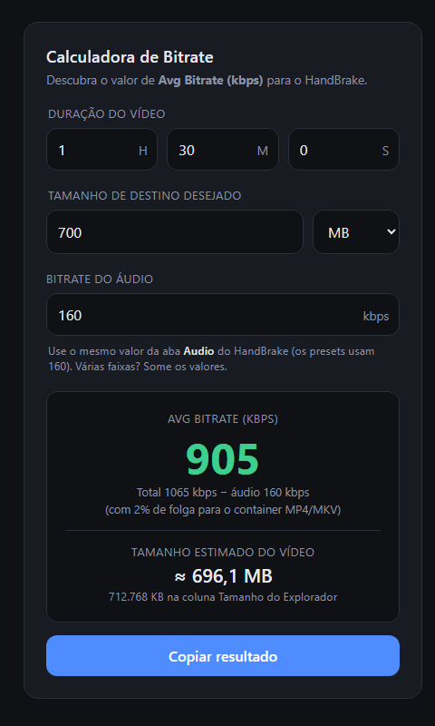
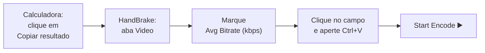
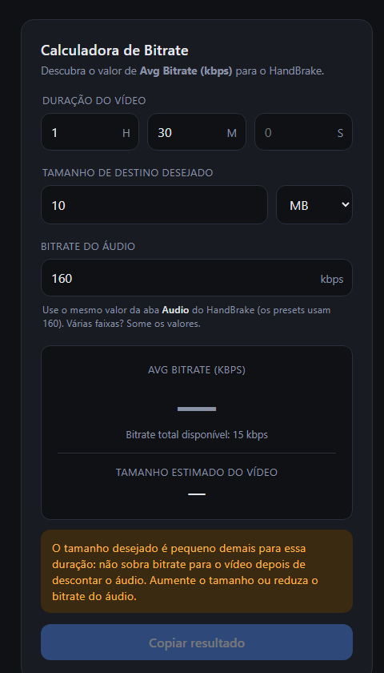
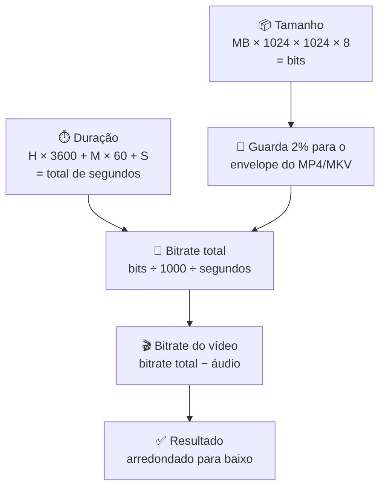
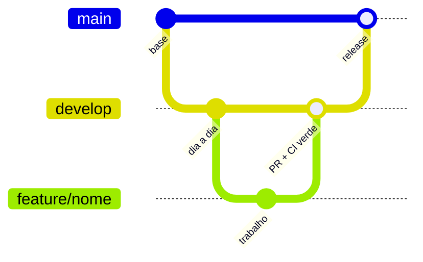

<div align="center">

# 🎬 Calculadora de Bitrate

### Descubra em 1 segundo qual número digitar no HandBrake para o vídeo ficar do tamanho que você quer.

[](https://github.com/guvon1982/calculadora-de-bitrate/actions/workflows/ci.yml)




**[⬇️ Baixar agora](https://github.com/guvon1982/calculadora-de-bitrate/archive/refs/heads/main.zip)** · [Como instalar](#instalacao) · [Como usar](#como-usar) · [Problemas comuns](#problemas)

</div>

---

## 🤔 O que é isto?

Você tem um vídeo grande e quer diminuir o tamanho dele (por exemplo, para caber num pendrive ou para enviar pela internet). Para isso, muita gente usa um programa gratuito chamado **HandBrake**.

O HandBrake pergunta um número chamado **"Avg Bitrate (kbps)"**. Esse número decide o tamanho final do vídeo. O problema: **ninguém sabe que número colocar.**

Esta calculadora resolve isso. Você diz:

| Você informa | Exemplo |
|---|---|
| ⏱️ Quanto tempo o vídeo dura | 1 hora e 30 minutos |
| 📦 Que tamanho você quer que ele tenha | 700 MB |
| 🔊 A qualidade do som *(já vem preenchido)* | 160 |

E ela responde: **digite `905` no HandBrake.** ✅

> 💡 **Analogia:** pense no tamanho do arquivo como uma mochila e no vídeo como uma viagem. Quanto mais longa a viagem (duração), menos coisa cabe por dia (bitrate). A calculadora divide a mochila igualmente pelos dias da viagem.

---

## 📋 Sumário

1. [O que você precisa ter](#requisitos)
2. [Instalação passo a passo](#instalacao)
3. [Como usar](#como-usar)
4. [Como a conta funciona](#conta)
5. [Problemas comuns](#problemas)
6. [Como desinstalar](#desinstalar)
7. [Para desenvolvedores](#desenvolvedores)

---

<a id="requisitos"></a>

## ✅ O que você precisa ter

| Item | Você já tem? |
|---|---|
| 💻 Um computador com **Windows 10** ou **Windows 11** | Provavelmente sim |
| 🌐 Um navegador de internet: **Google Chrome**, **Microsoft Edge**, **Firefox** ou **Opera** | **Sim.** Pode continuar usando o seu preferido. A calculadora abre na janela do **Edge**, que já vem instalado em todo Windows 10 e 11 |
| 🌍 Internet | **Só para baixar.** Depois, a calculadora funciona totalmente sem internet |
| 🔑 Senha de administrador | **Não precisa** |

---

<a id="instalacao"></a>

## 🛠️ Instalação passo a passo

São **5 passos**. Leva uns 3 minutos. Vá com calma, um passo de cada vez.


---

<a id="passo-1"></a>

### 1️⃣ Baixar

1. Clique neste link: **[⬇️ Baixar a Calculadora de Bitrate](https://github.com/guvon1982/calculadora-de-bitrate/archive/refs/heads/main.zip)**
2. O navegador vai baixar um arquivo chamado **`calculadora-de-bitrate-main.zip`**.
   - No Edge e no Chrome, aparece um aviso no **canto de cima, à direita** da tela quando termina.
3. Pronto. O arquivo foi para a pasta **Downloads** do seu computador.

> 🧭 **Como achar a pasta Downloads:** aperte a **tecla Windows** (a que tem o desenho de uma janelinha ⊞) e, sem soltar, aperte a letra **E**. Abre uma janela chamada **Explorador de Arquivos**. Na coluna da esquerda, clique em **Downloads**.

---

<a id="passo-2"></a>

### 2️⃣ Extrair (abrir o ZIP)

Um arquivo **ZIP** é como uma **caixa fechada com fita**: as coisas estão lá dentro, mas você precisa abrir a caixa e tirar tudo antes de usar.

1. Na pasta **Downloads**, procure o arquivo **`calculadora-de-bitrate-main`** (ele tem um ícone de pasta com um zíper 🗜️).
2. **Clique com o botão direito** em cima dele.
3. No menu que aparecer, clique em **"Extrair Tudo..."**.
4. Abre uma janelinha. Não precisa mudar nada: clique no botão **"Extrair"**.
5. Uma nova pasta vai abrir sozinha, chamada **`calculadora-de-bitrate-main`**. Dentro dela tem outra pasta com o mesmo nome. **Dê dois cliques** nela para entrar.

Você deve ver estes arquivos:

```
📄 INSTALAR.bat     ← é este que você vai usar
📄 index.html
🖼️ icone.ico
📄 instalar.ps1
📄 README.md
... e alguns outros (pode ignorar)
```

> ⚠️ **Importante:** não pule este passo! Se você tentar instalar direto de dentro do ZIP, sem extrair, **não vai funcionar**.

---

### 3️⃣ Instalar

1. **Dê dois cliques** no arquivo **`INSTALAR.bat`**.

   > 💡 Se você não vê o `.bat` no final do nome, procure só **`INSTALAR`** (com o ícone de uma engrenagem ⚙️ ou de uma janelinha preta).

2. **O Windows pode mostrar um aviso.** Isso é **normal**: o Windows avisa sempre que você abre um programa baixado da internet que não é de uma grande empresa. Veja qual aviso apareceu:

   <details>
   <summary>🛡️ <b>Tela azul: "O Windows protegeu o computador"</b> (clique aqui para ver o que fazer)</summary>

   1. Clique no texto pequeno **"Mais informações"** (fica embaixo do texto principal).
   2. Vai aparecer um botão novo: **"Executar assim mesmo"**. Clique nele.

   </details>

   <details>
   <summary>⚠️ <b>Janela: "Aviso de Segurança – Abrir Arquivo"</b> (clique aqui para ver o que fazer)</summary>

   1. Clique no botão **"Executar"**.

   </details>

3. Vai abrir uma **janela preta** com letras brancas. **Não se assuste**: é o instalador trabalhando. Em poucos segundos ela mostra:

   ```
   Pronto! Calculadora de Bitrate instalada em:
     C:\Users\SeuNome\AppData\Local\Programs\Calculadora de Bitrate
   Atalhos criados:
     ...\Desktop\Calculadora de Bitrate.lnk
     ...\Menu Iniciar\Programs\Calculadora de Bitrate.lnk

   Pressione qualquer tecla para continuar. . .
   ```

4. Aperte **qualquer tecla** (por exemplo, a barra de espaço) para fechar a janela preta.

✨ **Instalado!** O instalador copiou a calculadora para um lugar seguro do seu computador. Agora você **pode apagar** o arquivo ZIP e a pasta extraída da pasta Downloads, se quiser.

---

### 4️⃣ Abrir

Olhe a sua **Área de Trabalho** (a tela de fundo, que aparece quando todas as janelas estão fechadas). Apareceu um ícone novo, **azul, escrito `kbps`**, com o nome **Calculadora de Bitrate**.

**Dê dois cliques** nele. A calculadora abre numa janela própria. 🎉

> 🔎 Ela também aparece no **Menu Iniciar**: aperte a **tecla Windows**, digite **`calculadora de bitrate`** e aperte **Enter**.

---

### 5️⃣ Fixar na barra de tarefas (opcional, mas recomendado)

A **barra de tarefas** é a faixa que fica **embaixo da tela**, com o relógio no canto direito. Fixar a calculadora ali deixa ela **sempre a um clique de distância**.

<table>
<tr>
<th>🪟 No Windows 10</th>
<th>🪟 No Windows 11</th>
</tr>
<tr>
<td>

1. Vá até a **Área de Trabalho**.
2. **Clique com o botão direito** no ícone **Calculadora de Bitrate**.
3. Clique em **"Fixar na barra de tarefas"**.

</td>
<td>

1. Vá até a **Área de Trabalho**.
2. **Clique com o botão direito** no ícone **Calculadora de Bitrate**.
3. Clique em **"Mostrar mais opções"** (fica no final da lista).
4. Clique em **"Fixar na barra de tarefas"**.

</td>
</tr>
</table>

Pronto! O ícone azul `kbps` agora fica na barra de tarefas. É só **um clique** para abrir. 🚀

---

<a id="como-usar"></a>

## 🎯 Como usar


1. **Duração do vídeo:** digite as **horas** (H), os **minutos** (M) e os **segundos** (S). Campo vazio conta como zero.
2. **Tamanho de destino:** digite o tamanho que você quer e escolha **MB** ou **GB** na caixinha ao lado.
3. **Bitrate do áudio:** precisa ser **o mesmo número da aba Audio do HandBrake**. Os presets do HandBrake usam **160**, por isso ele já vem preenchido assim. Se você mudou o áudio lá, mude aqui também. Esse é o detalhe que mais faz o tamanho final errar.
4. O resultado aparece **na hora**, em **verde e grande**. Não precisa apertar nenhum botão para calcular.
5. Logo abaixo aparece o **tamanho estimado do vídeo**: quanto o arquivo deve ficar depois do HandBrake. A linha pequena mostra o mesmo tamanho em **KB**, porque é assim que a coluna **Tamanho** do Explorador mostra (por exemplo, `203.660 KB` é o mesmo que `198,9 MB`).
6. Clique em **"Copiar resultado"**. O botão muda para **"Copiado!"**.

<br clear="right">

### 📝 Usando o resultado no HandBrake



1. No HandBrake, abra o seu vídeo e vá na aba **Video**.
2. Na parte **Quality**, marque a opção **Avg Bitrate (kbps)**.
3. Clique dentro do campo ao lado, apague o que estiver lá e aperte **`Ctrl` + `V`** (segure `Ctrl` e aperte `V`) para colar o número.
4. **Dica de ouro:** marque também a caixinha **2-Pass Encoding** (em versões novas o nome é **Multi-Pass Encoding**). O HandBrake demora mais, mas acerta o tamanho com muito mais precisão.
5. Na aba **Audio**, confira a coluna **Bitrate**: tem que ser o mesmo número que você usou na calculadora (160, por padrão). Se tiver mais de uma linha (mais de uma faixa de áudio), some todas.

> **Dica:** se o áudio do vídeo original é **128 kbps**, colocar **160** no HandBrake não melhora o som. Coloque **128** na aba Audio do HandBrake **e** na calculadora. Assim sobra mais espaço para a imagem.

### 🚨 Quando aparece o aviso amarelo



Se você pedir um tamanho **pequeno demais** para a duração do vídeo, não sobra espaço nem para o som, quanto mais para a imagem. A calculadora mostra um **aviso amarelo** e desliga o botão de copiar.

**O que fazer:**
- Aumente o **tamanho de destino**, ou
- Diminua o **bitrate do áudio** (por exemplo, para 96 ou 64), ou
- Corte o vídeo para ele ficar mais curto.

<br clear="right">

---

<a id="conta"></a>

## 🧮 Como a conta funciona

**Bitrate** é a quantidade de informação que o vídeo usa **por segundo**. É medido em **kbps** (kilobits por segundo).



### Exemplo completo: vídeo de 1h30 para caber em 700 MB

| Etapa | Conta | Resultado |
|---|---|---|
| Duração em segundos | 1 × 3600 + 30 × 60 + 0 | **5.400 s** |
| Tamanho em bits | 700 × 1.048.576 × 8 | **5.872.025.600 bits** |
| Guarda 2% para o envelope | 5.872.025.600 × 0,98 | **5.754.585.088 bits** |
| Bitrate total | 5.754.585.088 ÷ 1000 ÷ 5.400 | **1.065,7 kbps** |
| Bitrate do vídeo | 1.065,7 − 160 | **905,7 kbps** |
| Arredonda para baixo | | **905** ✅ |

> **Por que 1024 × 1024?** É assim que o **Windows** conta o "MB" quando mostra o tamanho de um arquivo. Usamos a mesma régua que você vai usar para conferir.
>
> **Por que dividir por 1000?** No HandBrake, **1 kbps = 1000 bits por segundo** (e não 1024).
>
> **Por que guardar 2%?** O arquivo de vídeo (MP4 ou MKV) é como um **envelope** que guarda a imagem e o som juntos, e o envelope também ocupa espaço. Medimos num vídeo real: **1,5%**. Guardamos 2% por segurança.
>
> **Por que arredondar para baixo?** Para o vídeo **nunca passar** do tamanho que você pediu.

> 🎯 **Conferido com um vídeo de verdade.** Num vídeo de 1h19m23s com o HandBrake 1.10, a conta prevê o tamanho final com **erro menor que 0,1%**, e os testes automáticos do projeto checam isso.

---

<a id="problemas"></a>

## 🆘 Problemas comuns

<details>
<summary><b>Dei dois cliques no INSTALAR e deu erro, ou a janela preta fechou na hora</b></summary>

Você provavelmente está **dentro do ZIP**, sem ter extraído. Volte ao [passo 2️⃣](#passo-2) e use **"Extrair Tudo..."** antes.

</details>

<details>
<summary><b>A janela preta mostrou "Microsoft Edge não foi encontrado"</b></summary>

A calculadora usa o Microsoft Edge para abrir. Ele vem com o Windows, mas pode ter sido removido. Instale de novo em **https://www.microsoft.com/edge**, depois dê dois cliques no `INSTALAR.bat` outra vez.

</details>

<details>
<summary><b>A janela preta mostrou "Arquivo não encontrado"</b></summary>

Faltou algum arquivo ao lado do `INSTALAR.bat`. Apague a pasta extraída, **extraia o ZIP de novo** (passo 2️⃣) e tente outra vez.

</details>

<details>
<summary><b>Não aparece "Fixar na barra de tarefas" quando clico com o botão direito</b></summary>

No **Windows 11**, clique primeiro em **"Mostrar mais opções"**, no final da lista. A opção aparece no menu maior que abre.

Outra forma: aperte a **tecla Windows**, digite `calculadora de bitrate`, **clique com o botão direito** no resultado e escolha **"Fixar na barra de tarefas"**.

</details>

<details>
<summary><b>O botão "Copiar resultado" está apagado e não clica</b></summary>

Ele só funciona quando há um resultado. Confira se você preencheu a **duração** e o **tamanho**, e se não apareceu o **aviso amarelo**.

</details>

<details>
<summary><b>O vídeo final saiu maior do que eu queria</b></summary>

- Marque **2-Pass Encoding** / **Multi-Pass Encoding** no HandBrake.
- Confira se o bitrate do áudio no HandBrake é igual ao da calculadora.
- Se tiver **mais de uma faixa de áudio** (ex.: português + inglês), **some os bitrates** de todas no campo de áudio da calculadora (ex.: 160 + 160 = 320).
- Se você **cortou** o vídeo no HandBrake (escolheu só um trecho), digite na calculadora a duração **do trecho**, não a do vídeo inteiro.

</details>

<details>
<summary><b>Mudei o computador de lugar / formatei e o atalho sumiu</b></summary>

É só repetir a [instalação](#instalacao) desde o passo 1️⃣.

</details>

---

<a id="desinstalar"></a>

## 🗑️ Como desinstalar

1. **Clique com o botão direito** no ícone da barra de tarefas e escolha **"Desafixar da barra de tarefas"**.
2. Na **Área de Trabalho**, clique uma vez no ícone **Calculadora de Bitrate** e aperte a tecla **`Delete`**.
3. Aperte a **tecla Windows** + **R** ao mesmo tempo. Abre uma caixinha chamada **Executar**. Cole o texto abaixo e aperte **Enter**:

   ```
   %LOCALAPPDATA%\Programs
   ```

   Abre uma pasta. Clique uma vez na pasta **Calculadora de Bitrate** e aperte **`Delete`**.
4. Aperte **tecla Windows** + **R** de novo, cole o texto abaixo e aperte **Enter**:

   ```
   %APPDATA%\Microsoft\Windows\Start Menu\Programs
   ```

   Clique uma vez em **Calculadora de Bitrate** e aperte **`Delete`**.

Pronto, não sobra nada. 🧹

---

## 🔒 Privacidade

- A calculadora **não usa a internet**. Nenhum dado sai do seu computador.
- A página tem uma regra de segurança (*Content Security Policy*) que **bloqueia** qualquer tentativa de carregar algo de fora.
- O instalador **não pede administrador** e só mexe em pastas do seu próprio usuário.

---

<a id="desenvolvedores"></a>

## 👩‍💻 Para desenvolvedores

<details>
<summary><b>Estrutura do projeto</b></summary>

```
calculadora-de-bitrate/
├── index.html              # o app inteiro (HTML + CSS + JS, sem dependências)
├── icone.ico               # ícone dos atalhos
├── instalar.ps1            # instalador: copia o app e cria os atalhos do Edge em modo app
├── INSTALAR.bat            # atalho de dois cliques para o instalar.ps1
├── test/
│   ├── calculadora.test.js # renderiza o index.html no jsdom e testa como um usuário
│   └── instalar.test.js    # roda o instalador em pastas temporárias (só no Windows)
├── docs/img/               # screenshots do README
├── eslint.config.js        # lint do JS (inclusive o <script> dentro do HTML)
├── .htmlvalidate.json      # lint do HTML
└── .github/
    ├── workflows/ci.yml    # CI: audit + lint + testes no Windows
    └── dependabot.yml      # atualizações automáticas de dependências
```

</details>

<details>
<summary><b>Como rodar os testes</b></summary>

Requer **Node.js 22+**.

```bash
npm ci          # instala as ferramentas de desenvolvimento
npm run lint    # ESLint + html-validate
npm test        # testes (node --test)
npm run check   # lint + testes
```

O app em si **não tem dependências**: o `index.html` funciona sozinho. As dependências do `package.json` são só para lint e testes.

</details>

<details>
<summary><b>Como funciona o "app" no Windows</b></summary>

O atalho abre o `index.html` no Edge com a opção `--app=`, que mostra a página numa janela própria, sem abas e sem barra de endereço. O arquivo é aberto direto do disco (`file:///`), sem servidor.

</details>

<details>
<summary><b>Fluxo de branches</b></summary>



- `main`: versões prontas para uso (é dela que sai o link de download).
- `develop`: integração do dia a dia.
- `feature/<nome>`: cada funcionalidade ou correção. Entra em `develop` por PR, com CI verde.

</details>

---

<div align="center">

Feito para quem só quer que o vídeo caiba. 🎬📦

</div>
